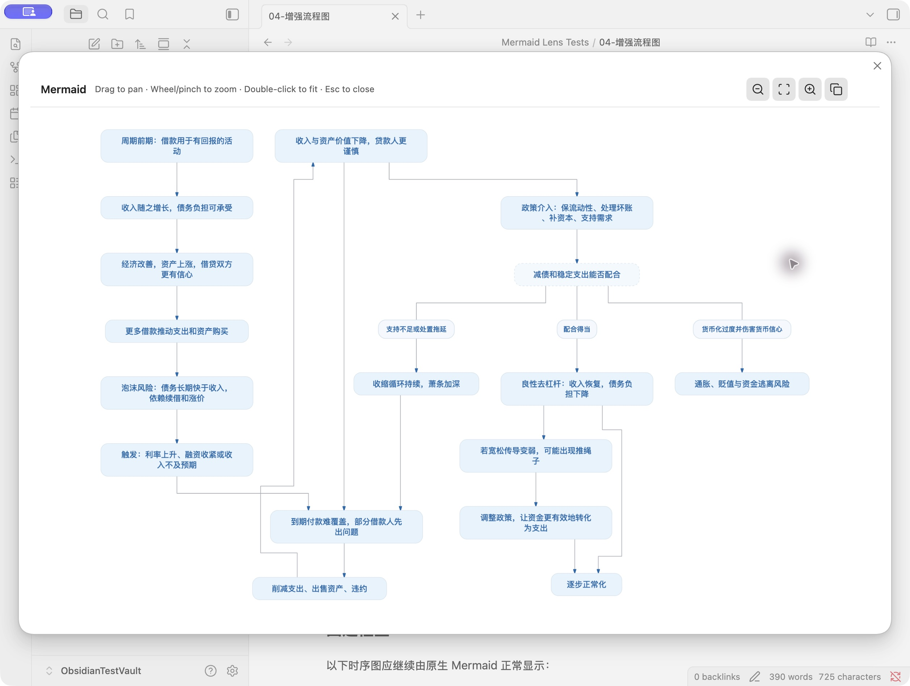
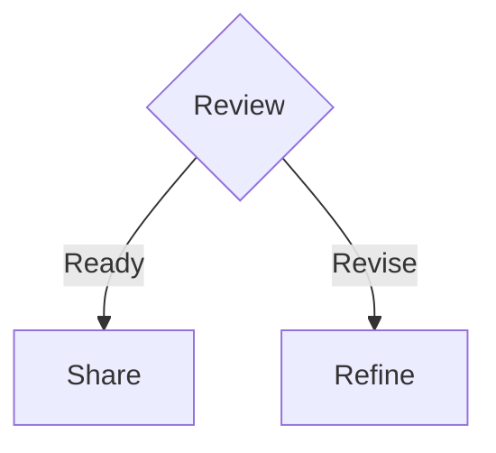

<picture>
  <source media="(max-width: 600px)" srcset="./assets/readme/hero-mobile.svg">
  
</picture>

**Write ordinary Mermaid. Get clearer flowcharts, a roomy viewer, and full-diagram image copying.**

[Download the plugin](https://github.com/DaleAndriy/obsidian-mermaid-lens-enhanced/releases/latest) · [简体中文](README.zh-CN.md) · [Changelog](CHANGELOG.md)

Obsidian **1.12+** · Desktop & mobile · **MIT** license

## See it in Obsidian

[](assets/readme/viewer.png)

An actual diagram from the [acceptance examples](fixtures/acceptance/04-增强流程图.md). Click the screenshot to inspect the connections at full size.

## What changes

- **Easier paths to follow.** Supported flowcharts get separate incoming and outgoing connections, fewer shared segments, aligned branch labels, and routes that avoid other nodes where possible.
- **A consistent look.** Light-blue rounded nodes, dashed decision boxes, pill labels, white group backgrounds, and a Chinese-capable font stack.
- **Space to explore.** Click a diagram to open a viewer. Drag to pan, zoom around the pointer, and copy the complete diagram as a JPEG, regardless of the current view.
- **Your notes stay the same.** Keep standard `mermaid` blocks. Unsupported diagram types and syntax fall back to Obsidian's native Mermaid renderer.

## Install

1. Download **`main.js`**, **`manifest.json`**, and **`styles.css`** from the [latest release](https://github.com/DaleAndriy/obsidian-mermaid-lens-enhanced/releases/latest).
2. Put the three files in this folder, creating it if needed:

   ```text
   <Vault>/.obsidian/plugins/mermaid-lens/
   ```

3. Reload Obsidian, then enable **Mermaid Lens Enhanced** under **Settings → Community plugins**. Turn off Restricted mode if needed.

Upgrading from Mermaid Lens? The enhanced fork keeps the `mermaid-lens` plugin ID. Replace those same three files and keep your existing `data.json` to preserve settings.

## Try it

Paste this into a note. Switch to Live Preview or Reading view, then click the rendered diagram to open the viewer.

````markdown

````

The header illustration is generated from this exact example using the plugin's renderer. [View the SVG output](assets/readme/example.svg).

| In the viewer | Action |
| --- | --- |
| Drag | Pan |
| Wheel or pinch | Zoom |
| Double-click or fit button | Fit the whole diagram |
| Copy button | Copy the full diagram as JPEG |
| `+` / `-` | Zoom in / out |
| `Esc` | Close |

Double-click and expand-button-only activation are also available in **Settings → Mermaid Lens Enhanced**. Links and buttons inside a diagram keep their own actions.

## Make it yours

The default theme is ready to use. To customize it, open **Settings → Mermaid Lens Enhanced → Global Mermaid configuration**. Edit the JSON, then choose **Apply and redraw**.

<details>
<summary>A small theme configuration</summary>

```json
{
  "theme": "base",
  "themeVariables": {
    "primaryColor": "#E7F3FC",
    "primaryBorderColor": "#D4E3EE",
    "primaryTextColor": "#1769AA",
    "lineColor": "#A6ADB4"
  }
}
```

Changes remain a draft until applied. If validation, application, or saving fails, the previous valid configuration is retained. **Restore defaults** restores the bundled Mermaid configuration. More options: [Mermaid configuration reference](https://mermaid.js.org/config/schema-docs/config.html).

</details>

## Compatibility

- Requires **Obsidian 1.12.0 or later**. Desktop and mobile are supported; image copying depends on the platform's clipboard capabilities.
- Enhanced rendering covers flowcharts, sequence, state, class, ER, and XY diagrams. Other types and unsupported syntax use the native renderer.
- Additional routing refinement applies to flat flowcharts with rectangular nodes. Grouped and other layouts retain the rendering library's geometry. Fewer crossings are a goal, rather than a guarantee for every graph.
- Existing saved configuration is preserved. Use **Restore defaults** to adopt the new light-blue theme. Other plugins that initialize Mermaid can affect the shared configuration.

## Development & credits

See [CONTRIBUTING.md](CONTRIBUTING.md) for builds and acceptance testing, and [CHANGELOG.md](CHANGELOG.md) for releases. Regenerate the SVG examples and headers with `node scripts/generate-readme-assets.mjs`.

Based on [Mermaid Lens by aitsuki](https://github.com/aitsuki/obsidian-mermaid-lens). Enhanced rendering uses [beautiful-mermaid](https://github.com/lukilabs/beautiful-mermaid). The original copyright is retained; project source is available under the [MIT license](LICENSE). Bundled dependencies retain their own licenses in the distributed JavaScript.
