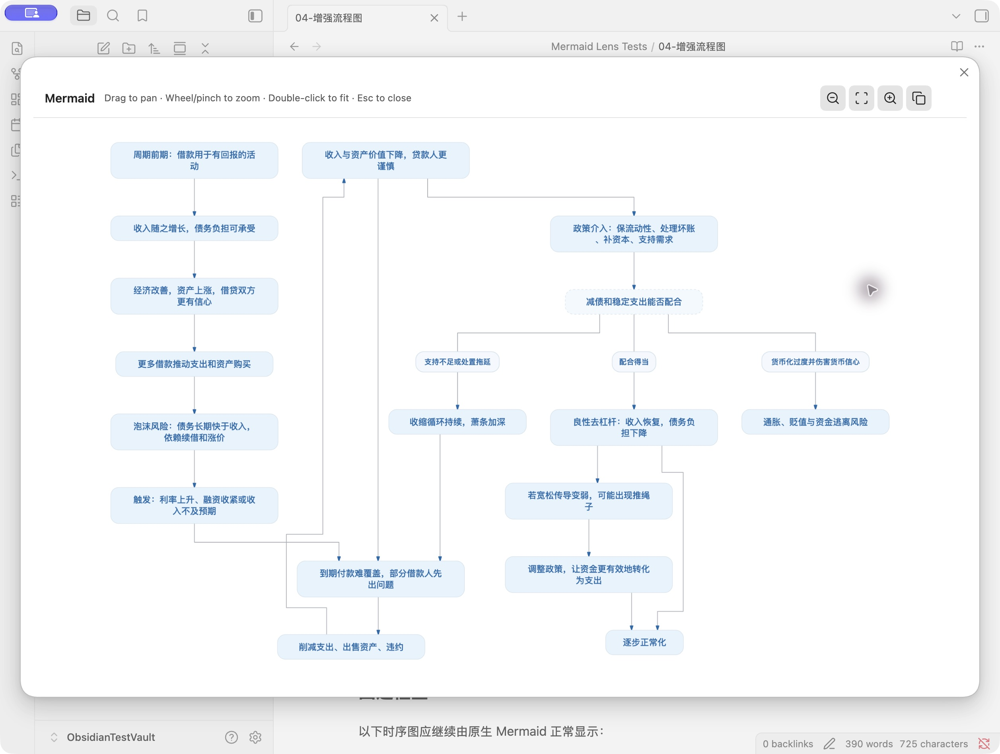
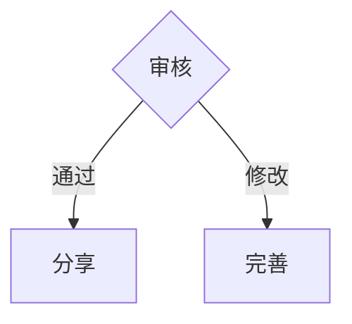

<picture>
  <source media="(max-width: 600px)" srcset="./assets/readme/hero-zh-mobile.svg">
  
</picture>

**照常写 Mermaid，让流程图更易读；大图可以自由缩放，也能整张复制为图片。**

[下载插件](https://github.com/DaleAndriy/obsidian-mermaid-lens-enhanced/releases/latest) · [English](README.md) · [更新记录](CHANGELOG.md)

Obsidian **1.12+** · 桌面端与移动端 · **MIT** 许可

## 在 Obsidian 中的实际效果

[](assets/readme/viewer.png)

截图来自项目的[验收示例](fixtures/acceptance/04-增强流程图.md)。点击图片可以查看原图，沿着连线追踪每个分支。

## 有哪些改进

- **连线更容易追踪。** 在支持的流程图中，进线和出线分别连接，减少共用线段，让分支标签对齐，并尽量绕开其他节点。
- **图表外观更统一。** 默认使用浅蓝圆角节点、虚线判断框、胶囊式标签、白色分组背景，以及支持中文的字体。
- **大图有足够的查看空间。** 单击图表即可打开查看器，拖拽平移、围绕光标缩放，也能把完整图表复制为 JPG，不受当前视野影响。
- **已有笔记直接可用。** 继续使用普通的 `mermaid` 代码块。增强渲染器不支持的图种和语法，会交回 Obsidian 原生 Mermaid 渲染。

## 安装

1. 从[最新版本](https://github.com/DaleAndriy/obsidian-mermaid-lens-enhanced/releases/latest)下载 **`main.js`**、**`manifest.json`** 和 **`styles.css`**。
2. 将三个文件放入以下目录；目录不存在时，新建即可：

   ```text
   <Vault>/.obsidian/plugins/mermaid-lens/
   ```

3. 重新加载 Obsidian，在“设置 → 第三方插件”中启用 **Mermaid Lens Enhanced**。如仍处于受限模式，需先关闭。

从 Mermaid Lens 升级时，直接替换这三个文件即可。增强版保留了 `mermaid-lens` 插件 ID；留下原来的 `data.json`，就能沿用已有设置。

## 试一张流程图

将以下内容粘贴到笔记中。切换到实时预览或阅读视图，单击渲染出的图表即可打开查看器。

````markdown

````

页首的流程图就是插件渲染这段代码的结果。[查看 SVG 原图](assets/readme/example-zh.svg)。

| 在查看器中 | 操作效果 |
| --- | --- |
| 拖拽 | 平移图表 |
| 滚轮或双指缩放 | 放大、缩小 |
| 双击或点击适配按钮 | 显示完整图表 |
| 点击复制按钮 | 将整张图复制为 JPG |
| `+` / `-` | 放大 / 缩小 |
| `Esc` | 关闭查看器 |

也可以在“设置 → Mermaid Lens Enhanced”中改为双击打开，或仅通过展开按钮打开。图表中的链接和按钮仍可正常使用。

## 调整外观

默认主题开箱即可使用。需要自定义时，进入“设置 → Mermaid Lens Enhanced → 全局 Mermaid 配置”，修改 JSON，再点击“应用并重绘”。

<details>
<summary>一份简单的主题配置</summary>

```json
{
  "theme": "base",
  "themeVariables": {
    "primaryColor": "#E7F3FC",
    "primaryBorderColor": "#D4E3EE",
    "primaryTextColor": "#1769AA",
    "lineColor": "#A6ADB4"
  }
}
```

编辑中的内容只是草稿，点击应用后才会验证和保存。验证、应用或保存失败时，会保留上一份有效配置。“恢复默认配置”可还原插件自带的设置。更多字段见 [Mermaid 配置文档](https://mermaid.js.org/config/schema-docs/config.html)。

</details>

## 兼容性与使用范围

- 最低支持 **Obsidian 1.12.0**，可用于桌面端和移动端；图片复制取决于所在平台的剪贴板能力。
- 增强渲染支持流程图、时序图、状态图、类图、ER 图和 XY 图。其他图种或不支持的语法使用原生渲染。
- 额外的连线路由优化用于无分组、矩形节点的流程图；分组图和其他布局保留渲染库的几何结果。复杂图表仍可能出现交叉。
- 插件会保留已有配置。升级后若想采用浅蓝默认主题，可点击“恢复默认配置”。其他会初始化 Mermaid 的插件可能影响共享配置。

## 开发与致谢

构建和验收方法见 [CONTRIBUTING.md](CONTRIBUTING.md)，版本变化见 [CHANGELOG.md](CHANGELOG.md)。运行 `node scripts/generate-readme-assets.mjs` 可以重新生成页首插图和 SVG 示例。

本项目基于 [aitsuki 的 Mermaid Lens](https://github.com/aitsuki/obsidian-mermaid-lens)，增强渲染使用 [beautiful-mermaid](https://github.com/lukilabs/beautiful-mermaid)。保留原作者版权声明，项目源码采用 [MIT 许可](LICENSE)；打包的依赖保留各自许可，随发布的 JavaScript 一起提供。
