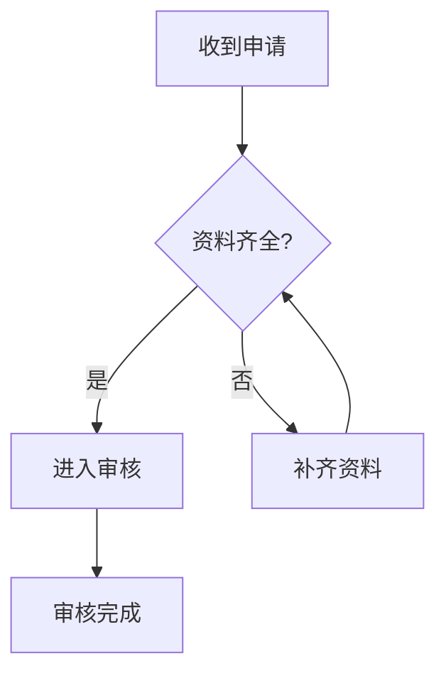
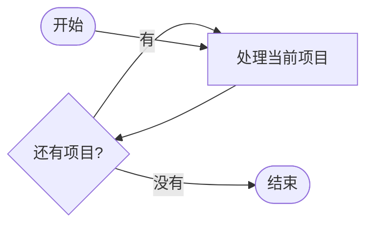
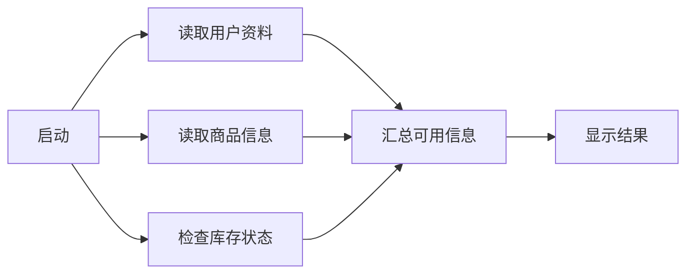
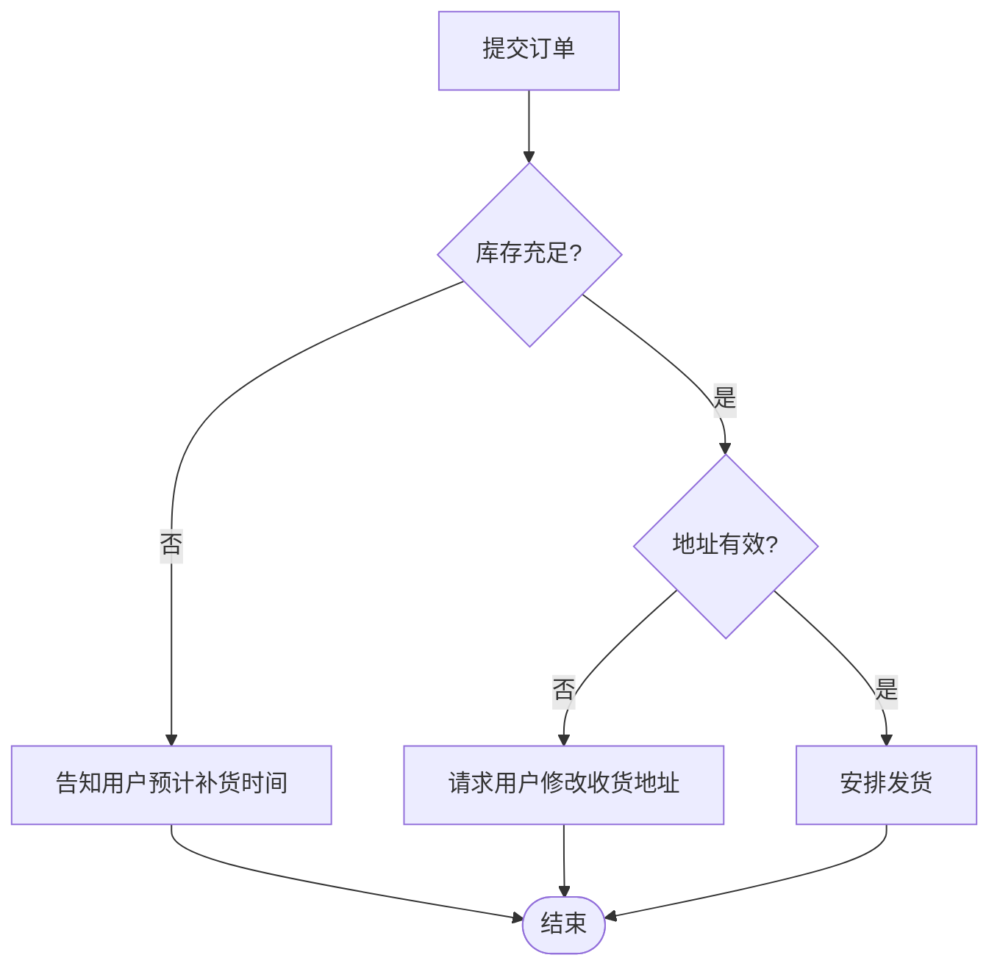
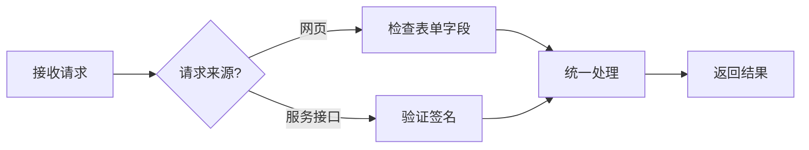
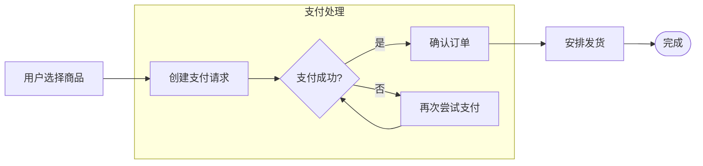

# 常见流程图布局样例

这些短图用于人工查看不同拓扑的节点位置、边标签、分支汇合、回路和子图边界。结构参考 Mermaid 官方的[基础流程图示例](https://mermaid.js.org/syntax/examples.html)与[流程图语法文档](https://mermaid.js.org/syntax/flowchart.html)，具体节点和流程为本验收页编写。

## 1. 分支后汇合

检查左右分支能否清楚地汇入同一节点。

## 2. 短回路与出口

检查回到前置处理节点的边是否挤入主干。

## 3. 多路输入后汇总

检查多个同层节点汇入一个结果节点时的进线间距与折弯。

## 4. 连续判断与共同结束

检查分支标签、长节点文字和多条路径汇合。

## 5. 两组处理步骤汇合

检查左右两条路径长度不同，且最终汇入同一节点时的布局。

## 6. 子图内分支与外部连接

检查分组边界、组内回路以及跨越分组的连接。

